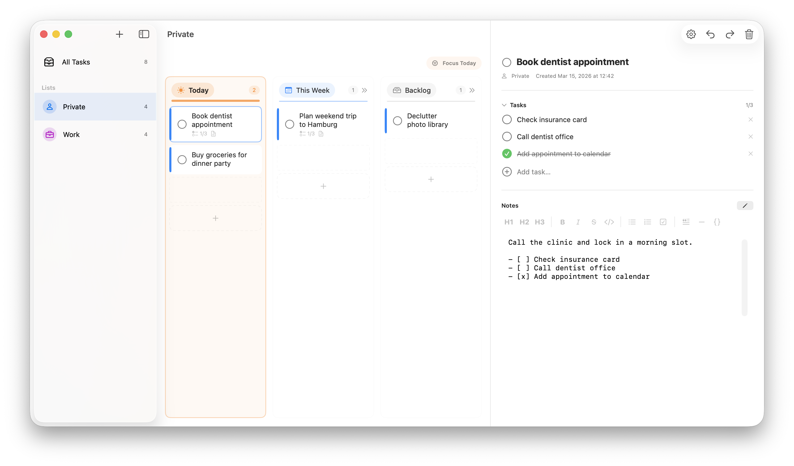

# today-md

Native macOS task manager for planning work across `Today`, `This Week`, and `Backlog`.

Built with SwiftUI, `@Observable` models, and a local SQLite store, `today-md` keeps tasks, subtasks, and Markdown notes in a lightweight local-first desktop app.

The Mac App Store edition is a free download limited to **one list and five total tasks**. A **$19.99 one-time today-md Pro unlock** removes those limits and enables Calendar Planner, Week View, folder sync, and external Markdown reconciliation. Source builds and GitHub releases continue to include the complete feature set under the MIT license.



## Features

- Multiple task lists with custom names, icons, and colors
- Kanban-style planning lanes for `Today`, `This Week`, and `Backlog`
- Task detail view with subtasks and Markdown notes
- Drag-and-drop task movement and reordering
- Global search across task titles, notes, and subtasks from the centered toolbar search field
- Import and export of task data as JSON backups, with markdown note exports alongside them
- Automatic mirror of every task as a `.md` file in Application Support
- Obsidian-compatible markdown round-tripping for editing existing tasks and creating new ones from the markdown archive or sync folder
- Seeded sample data on first install

## Tech Stack

- Swift 6
- SwiftUI
- Observation (`@Observable`)
- SQLite with FTS-backed search
- AppKit integrations for file import/export panels

## Requirements

- macOS 14.0+
- Swift 6.2+

## Getting Started

Build from the command line:

```bash
swift build
swift run today-md
```

For a real macOS app launch with the proper app icon, build and open the `.app` bundle instead:

```bash
bash scripts/dev-run.sh
```

Or open `today-md.xcodeproj` in Xcode and run `today-md-github` for the direct edition. The `today-md` scheme is for App Store and StoreKit development. GitHub Debug builds use local ad hoc signing, do not enable the hardened runtime, and do not check for updates. Release builds enable the hardened runtime and use the signed release pipeline. Plain `swift build` and `swift test` do not depend on Sparkle.

The app stores its local data in SQLite. In development builds that is `~/Library/Application Support/today-md/today-md.sqlite`; the sandboxed app bundle stores the same data inside its macOS container. Packaged app builds seed sample data on first launch. `swift run` now launches against a dedicated showcase database in `.build` and resets it to the example dataset on every local start.

## Project Structure

- `Package.swift`: Swift Package manifest for `swift build` / `swift run`
- `today-md/TodayMdApp.swift`: app entry point and SQLite-backed observable store
- `today-md/ContentView.swift`: split-view shell, search, settings, import, and export flows
- `today-md/Models`: observable models plus codable archive types
- `today-md/Helpers/TodayMdDatabase.swift`: SQLite schema, load/save, and full-text search
- `today-md/Helpers/TodayMdTransferService.swift`: JSON backup import/export and markdown archive mirroring
- `today-md/Views`: board, sidebar, and task detail UI

## Installation

Download the latest `.zip` from the [Releases](https://github.com/arthurliebhardt/today-md/releases) page.

1. Unzip the downloaded archive.
2. Move `today-md.app` to your Applications folder.
3. Open the app.

New GitHub releases built by the signed release workflow are Developer ID signed and notarized. The first release containing Sparkle must be installed manually; later releases can update through **today-md → Check for Updates…**. Automatic checking can be changed in **Settings → Updates**.

Older GitHub releases were not notarized. If macOS blocks an older release, use **System Settings → Privacy & Security → Open Anyway** after checking that you downloaded it from this repository.

## Data Portability

Each export creates a dated `today-md-eport-{date}` folder containing the JSON backup and a markdown notes folder. Imported data can either be merged into the existing SQLite store or replace it completely.

Every task is mirrored automatically as a Markdown file in `~/Library/Application Support/today-md/Markdown Archive/`. Editing those files updates the app on the next archive reconciliation pass, and new `.md` files created there or inside a sync folder can be imported as tasks.

New Markdown files without task IDs receive stable identities based on their filenames; the next archive export embeds those IDs in the files. Applying changes from folder sync or external Markdown clears earlier task undo/redo history so an undo cannot overwrite the imported changes. Subsequent local edits can still be undone.

Search is powered by a local SQLite full-text index over task titles, markdown notes, and subtask text.

## Contributing

Contributions are welcome. See [`CONTRIBUTING.md`](CONTRIBUTING.md) for setup, workflow, and pull request guidelines.

## License

Released under the MIT License. See [`LICENSE`](LICENSE).

## GitHub releases and updates

See [the release guide](RELEASE.md) for signing credentials, the one-time Sparkle key setup, release commands, and end-to-end update verification. Version and build numbers live in `Config/Version.xcconfig`. The `today-md-github` target contains Sparkle; the App Store target does not link or embed it.
